# YouTube Web Client Architecture & Workflow Flowcharts

Dokumentasi alur kerja dan *flowchart* untuk seluruh modul JavaScript YouTube yang telah diunduh dan dideobfuskasi ke dalam folder `deobfs/`.

---

## 1. Arsitektur Global & Relasi Antar File

Berikut adalah peta interaksi bagaimana ke-9 modul bekerja bersama saat halaman YouTube dimuat di browser:

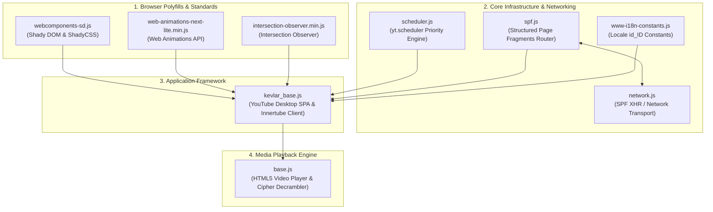

---

## 2. `base.js` — YouTube HTML5 Video Player

**Peran:** Engine pemutar video HTML5 YouTube (`_yt_player`). Mengatur streaming video adaptif (DASH/MSE), pemecahan cipher signature & n-parameter, UI kontrol pemutar, subtitle, serta telemetri QoS.

### Alur Kerja (Flowchart)

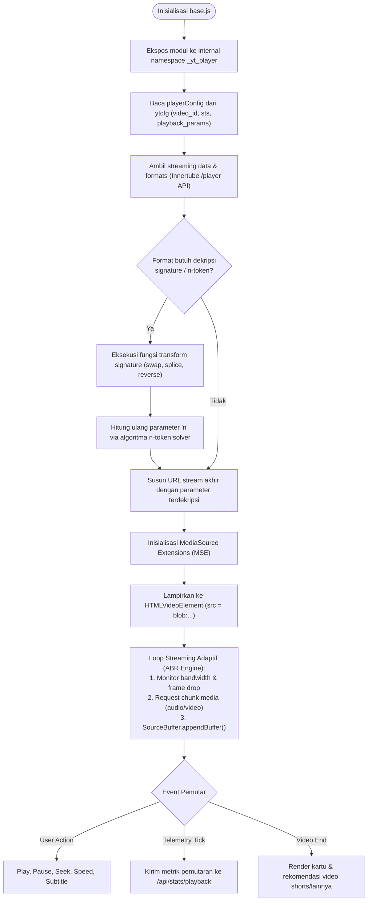

---

## 3. `kevlar_base.js` — YouTube Desktop Web App (Kevlar SPA)

**Peran:** Core single-page application (SPA) desktop YouTube. Berisi ribuan komponen Polymer, routing aplikasi, state store (Redux/Flux-like), integrasi Service Worker, dan klien API Innertube.

### Alur Kerja (Flowchart)

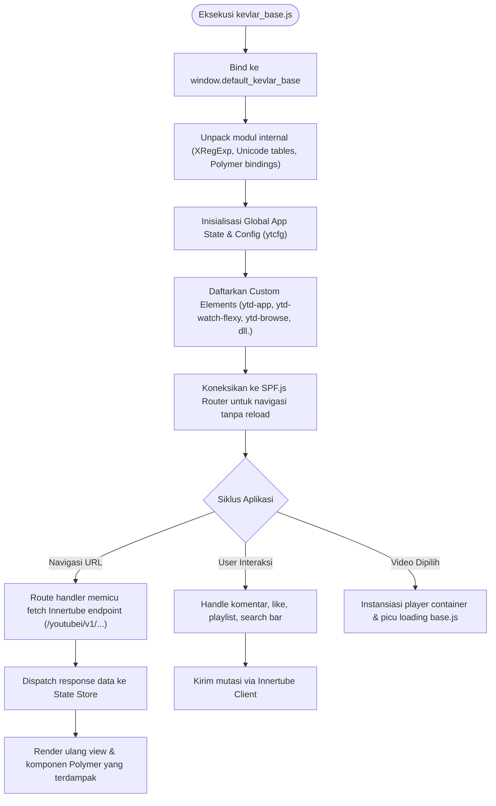

---

## 4. `spf.js` — Structured Page Fragments (SPA Router)

**Peran:** Framework pjax/SPA dari YouTube. Mengubah link navigasi reguler menjadi AJAX requests, menerima potongan JSON (head, body, CSS/JS), dan menukar elemen DOM secara dinamis tanpa me-refresh seluruh halaman.

### Alur Kerja (Flowchart)

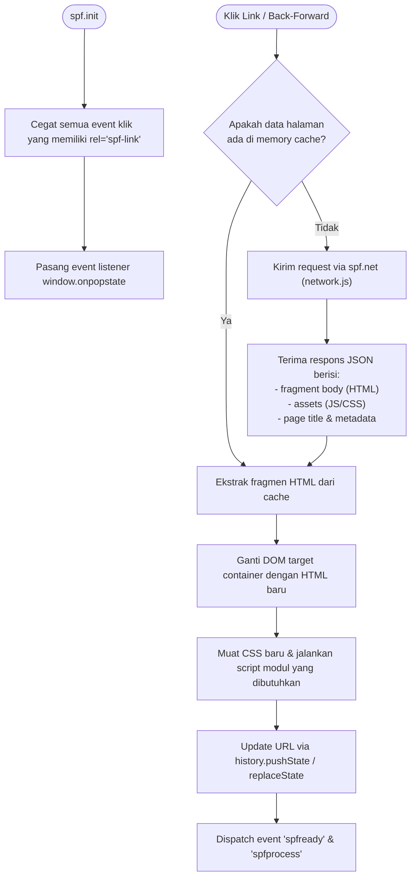

---

## 5. `network.js` — SPF Network Transport

**Peran:** Lapisan transport jaringan untuk SPF. Menyusun XMLHttpRequest dengan header khusus YouTube (`X-SPF-*`), mengukur Resource Timing, menangani timeout, dan parsing payload JSON.

### Alur Kerja (Flowchart)

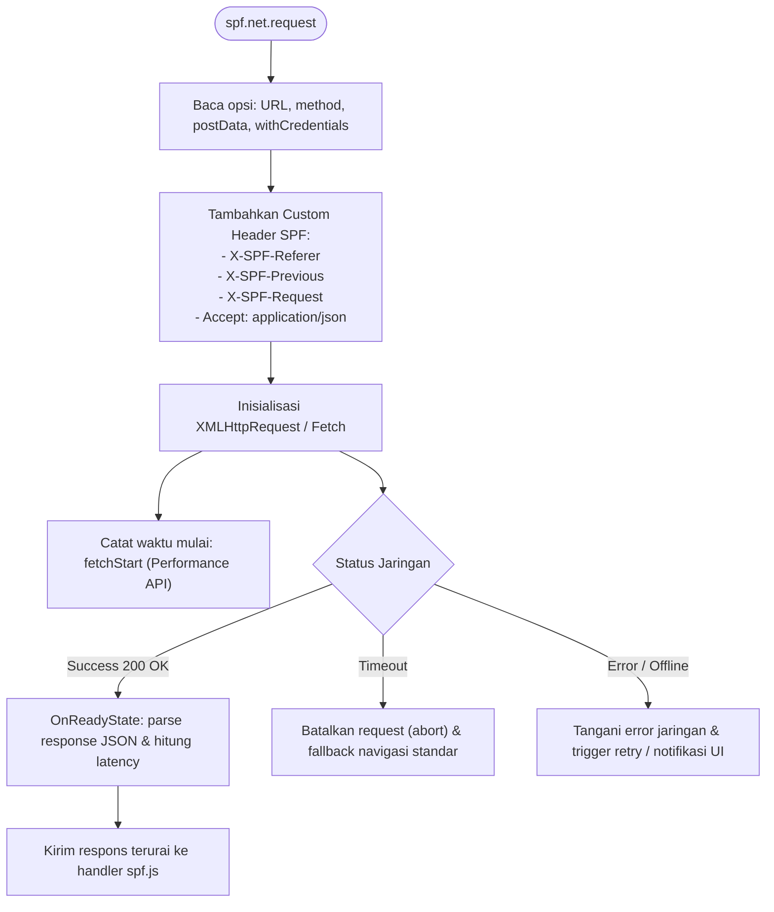

---

## 6. `scheduler.js` — YouTube Cooperative Task Scheduler

**Peran:** Mesin penjadwal prioritas tugas (`yt.scheduler`). Membagi beban kerja CPU ke dalam microtask dan idle-callbacks (`requestIdleCallback`) agar animasi dan streaming video tidak patah-patah (anti jank).

### Alur Kerja (Flowchart)

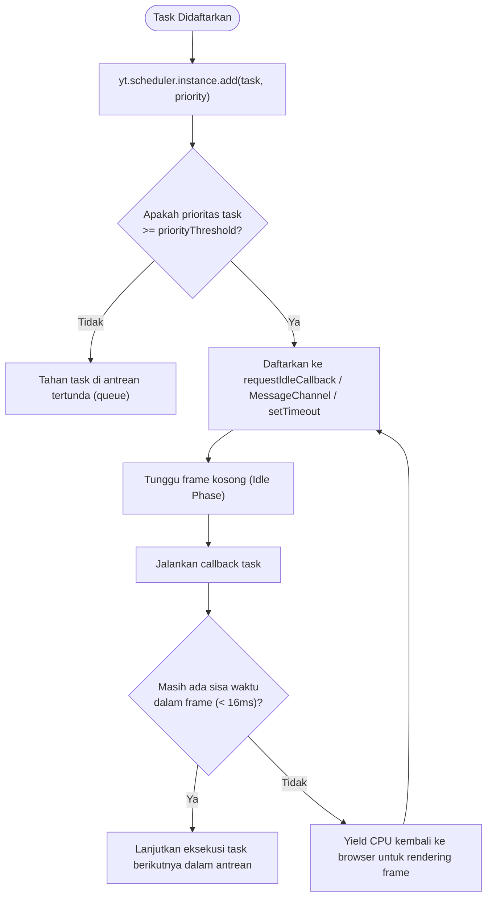

---

## 7. `webcomponents-sd.js` — Shady DOM & ShadyCSS Polyfill

**Peran:** Polyfill Shady DOM dan ShadyCSS untuk browser yang tidak memiliki implementasi native Shadow DOM v1. Mengemulasikan enkapsulasi CSS dan tree scoping pada komponen Polymer YouTube.

### Alur Kerja (Flowchart)

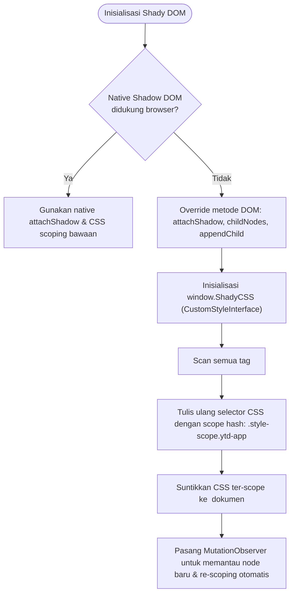

---

## 8. `web-animations-next-lite.min.js` — Web Animations API Polyfill

**Peran:** Implementasi standar Web Animations API (WAAPI) lite. Menyediakan dukungan `Element.prototype.animate()`, `KeyframeEffect`, dan `GroupEffect` untuk transisi fluid di UI YouTube.

### Alur Kerja (Flowchart)

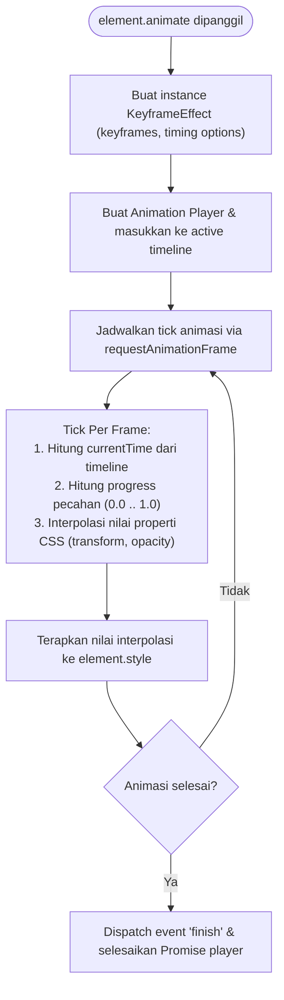

---

## 9. `intersection-observer.min.js` — Intersection Observer Polyfill

**Peran:** Polyfill standar W3C Intersection Observer. Mengamati visibilitas elemen terhadap viewport browser; esensial untuk lazy loading thumbnail video dan penghitungan impresi metrik iklan.

### Alur Kerja (Flowchart)

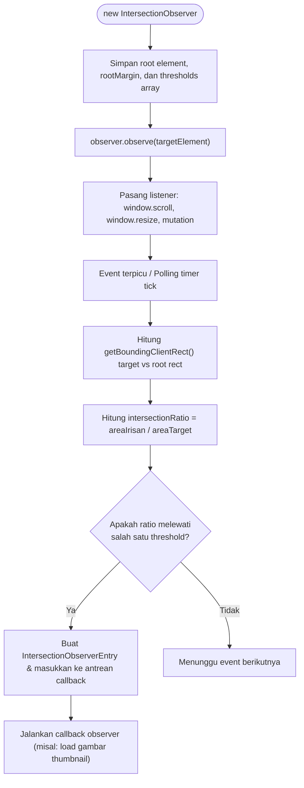

---

## 10. `www-i18n-constants.js` — Closure i18n Date/Time Constants (id_ID)

**Peran:** Konstanta lokalisasi Closure Library (`goog.i18n.DateTimeSymbols`) khusus bahasa Indonesia (`id_ID`). Menyediakan format tanggal, nama bulan, nama hari, dan unit waktu relatif ("x menit yang lalu").

### Alur Kerja (Flowchart)

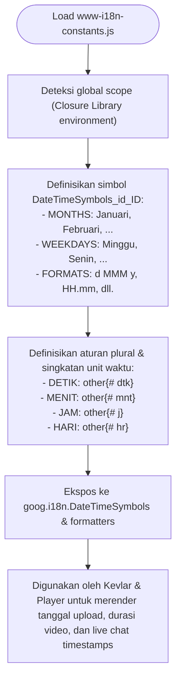

---

## 11. Komponen Ekstensi Tambahan

### 11.1 `components/serviceworker.js` — YouTube PWA Service Worker
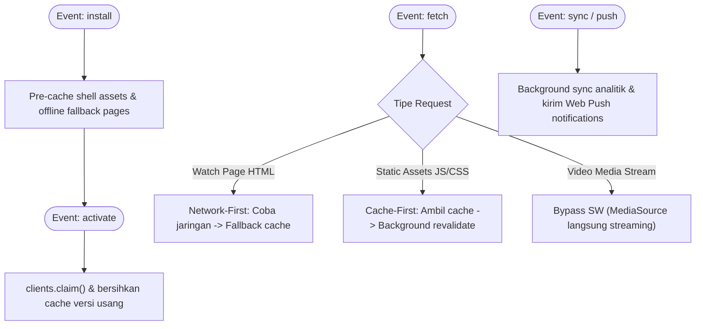

### 11.2 `components/captions.js` — Subtitle & Closed Captions Engine
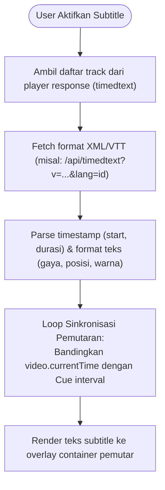

### 11.3 `components/remote.js` — Google Cast & Remote Screen Controller
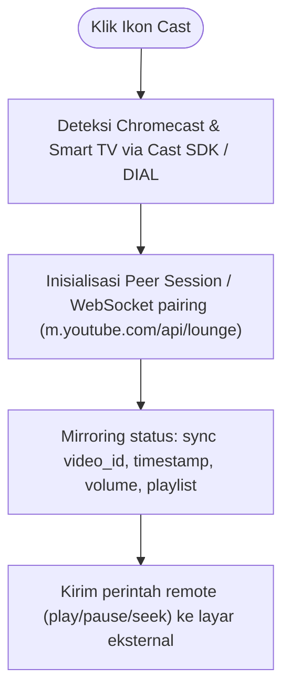

### 11.4 `components/embed.js` — IFrame Embed API Runtime
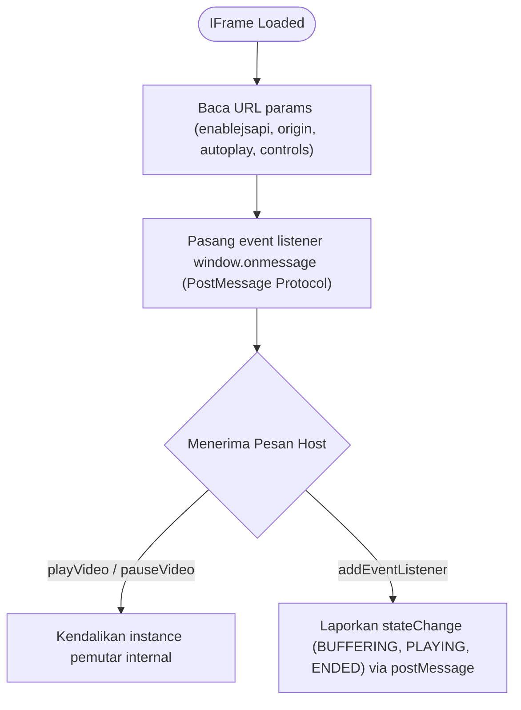

---

## Ringkasan Struktur File

| File Asli | File Deobfuskasi | Ukuran Asli | Kategori / Tanggung Jawab |
|---|---|---|---|
| `base.js` | `deobfs/base/deobfuscated.js` | 2.6 MB | HTML5 Player Engine, Cipher/Signature Decryption, MSE Streaming |
| `kevlar_base.js` | `deobfs/kevlar_base/deobfuscated.js` + modules | 9.4 MB | Desktop Web App (Polymer SPA), Innertube Client, Router Bridge |
| `spf.js` | `deobfs/spf/deobfuscated.js` | 38 KB | Structured Page Fragments (PWA / PJAX Navigation Framework) |
| `network.js` | `deobfs/network/deobfuscated.js` | 15 KB | Transport XHR/Fetch khusus SPF dengan custom headers |
| `scheduler.js` | `deobfs/scheduler/deobfuscated.js` | 8.1 KB | Cooperative Task Scheduler (prioritas eksekusi task) |
| `webcomponents-sd.js` | `deobfs/webcomponents-sd/deobfuscated.js` | 78 KB | Shady DOM & ShadyCSS Polyfill untuk Polymer components |
| `web-animations-next-lite.min.js` | `deobfs/web-animations-next-lite.min/deobfuscated.js` | 50 KB | Web Animations API Polyfill untuk transisi UI |
| `intersection-observer.min.js` | `deobfs/intersection-observer.min/deobfuscated.js` | 5.5 KB | W3C IntersectionObserver Polyfill (Lazy-load thumbnail) |
| `www-i18n-constants.js` | `deobfs/www-i18n-constants/deobfuscated.js` | 6.2 KB | Konstanta lokalisasi Closure Library (`id_ID`) |
